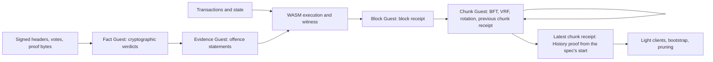

# Neutrin0 overview

Neutrin0 is a Rust proof-of-stake chain whose finality is a proof. Ordinary
execution runs one state-transition function (STF), an Osaka EVM, compiled to
WASM and run under wasmtime. The same STF compiles into an SP1 Guest, and SP1
Compressed STARK proofs establish block execution, the validity of objective
evidence and the consensus of each chunk of blocks. A node therefore never has
to trust another node's execution: it verifies a receipt, and a chunk is final
only once a proof of its complete consensus transition verifies.

## Trust model

A verifier trusts the chain specification and nothing else. The specification
pins every genesis program identity (the runtime's WASM content hash and the
Fact, Evidence, Block and Chunk Guest keys), the artifacts' content hashes and
the initial consensus context; its hash is the `ChainBinding` and enters every
consensus signature domain. The Fact and Chunk Guests are fixed for the life of
a chain, so changing either, or the SP1 version, is a hard fork. The runtime and
the Evidence and Block Guests are governable through on-chain program switches
at chunk boundaries ([upgrades and forks](20-upgrades-and-forks.md)).

There is one current protocol format, with unversioned types, fields and
paths. An incompatible change replaces it directly and nodes recreate their
databases: no older proof, transaction or database format is accepted and there
are no migrations.

## Architecture

### Node

The `neutrin0-node` binary assembles one `consensus-engine` `Engine` with libp2p
networking, the sync driver, the transaction pool, JSON-RPC and proof workers.
The engine owns chain state and deterministic orchestration: production,
import, fork choice, chunk BFT, finalization, retention, bootstrap and signing
journals. `ChainBackend` in the node crate connects it to execution, proving,
gossip, RPC and sync, and runs proof generation and verification outside the
engine lock. The configured role (`validator`, `full`, `reporter`, `archive` or
`light-client`) decides which of these run and what the node retains. The
[crate layout](01-crate-layout.md) maps each component to its crate.

### Execution and proofs

`runtime-abi` defines the Borsh wire contract between the node and the runtime,
`runtime-core` the authenticated state backends, and the EVM runtime's `core`
crate the STF, which builds into the WASM `master` and the SP1 Block `guest`.
`runtime-host` embeds the WASM and the four Guest ELFs, runs wasmtime and drives
SP1 ([runtime interface](02-runtime-interface.md),
[EVM runtime](03-evm-runtime.md)). A node uses one CPU or CUDA prover for all
four Guests and always verifies locally. `prover-chunk` holds the consensus
validation that the native node and the Chunk Guest share
([proof system](06-proof-system.md)). State lives in a Poseidon2 binary sparse
Merkle trie in RocksDB, read on demand and reference counted
([state and storage](04-state-and-storage.md)).

### Block lifecycle

A block is executed once, by its producer. The producer runs it in WASM,
records its witness and write set, and publishes `CandidateBlock { block,
writes }`. Whoever proves the block publishes its `BlockReceipt`. Validators,
full nodes and reporters import both without executing: the receipt must verify
under locally derived public inputs and the writes must reproduce the header's
state root over the exact parent state. Archives execute by default. The block
transition is total, so every signed block has exactly one correct execution and
a receipt ([proof-following nodes](07-proof-following-nodes.md),
[block format](05-block-format.md)). Fork choice, slots and proposer election
are in [consensus](09-consensus.md); the payment of block and chunk provers is
in the [proof market](08-proof-market.md).

### Chunk lifecycle

A chunk is a fixed number of consecutive blocks. Once every height has a
selectable receipt, the round leader signs a `BftProposal` naming one receipt per
height and, after the specification's first chunk, one proof of the previous
chunk. Validators prevote and precommit on that value
([BFT protocol](10-bft-protocol.md)). The resulting certificate lets nodes
execute one successor chunk before the proof exists
([certified execution](11-certified-execution.md)), while the round-0 leader of
the next chunk proves this one by default.

The Chunk Guest recursively verifies the selected block receipts and the
previous chunk's receipt, checks the complete BFT transition and derives the
next `ConsensusBoundary`: parent hash and state, validator root,
identity-sanctions root, seed, history root and program set. Finalization
verifies that proof against the trusted incoming boundary and stores the next
one atomically. Validator rotation is installed only by complete chunk
finalization ([chunk proofs](12-chunk-proofs.md)). The finalized seed feeds
proposer election and leader selection ([randomness](15-randomness.md)).

### History, light clients and bootstrap

Each chunk proof verifies its predecessor and the first starts at the boundary
the specification pins (genesis, or a hard fork's start), so the latest
finalized chunk receipt proves the whole chain and is the History proof; there
is no separate History prover ([recursive history](13-recursive-history.md)). A
proof-only light client accepts a peer's receipt for an endpoint that a quorum of
sampled peers advertise identically, together with an opening that places its
own endpoint on that chain ([light clients](14-light-clients.md)). Snapshot
bootstrap verifies the same proof and an opening of the local trust boundary
before installing state. Neither path treats a peer advertisement as an
authenticated anchor. Full and validator nodes prune sources older than the
eight-chunk finalized window; archives keep everything.

### Accountability

Nodes observe signed headers, votes and proposals and retain them within the
evidence window ([evidence availability](17-evidence-availability.md)). The Fact
Guest compresses exact signature and proof verdicts, the Evidence Guest proves
objective offences, and blocks admit them as `SubmitEvidence` transactions and
execute the mandatory sanction queue before ordinary transactions
([evidence proofs](16-evidence-proofs.md)). Reporter nodes keep the sources that
keep slashable identities accountable after the window closes
([reporter nodes](18-reporter-nodes.md)). Validator keys, the remote signer and
the signing journals that prevent equivocation are in
[validator keys](19-validator-keys.md).

## Reading map

| Document | Subject |
| --- | --- |
| [00 overview](00-overview.md) | What Neutrin0 is, its trust model and the architecture map |
| [01 crate layout](01-crate-layout.md) | Every crate, its responsibility and the two Guest packages outside the workspace |
| [02 runtime interface](02-runtime-interface.md) | Runtime wire contract, WASM host ABI, execution, witnesses, genesis, packages and operational queries |
| [03 EVM runtime](03-evm-runtime.md) | Osaka EVM execution, system precompiles, SP1 acceleration and the Ethereum RPC facade |
| [04 state and storage](04-state-and-storage.md) | State trie, witnesses, database columns, reference counting, pruning and storage quotas |
| [05 block format](05-block-format.md) | Headers, bodies, data lanes, commitments and the wire codec |
| [06 proof system](06-proof-system.md) | The four SP1 Guests, their statements and keys, and proof verification |
| [07 proof-following nodes](07-proof-following-nodes.md) | Candidate and receipt publication, import without execution, stale candidates |
| [08 proof market](08-proof-market.md) | Receipt selection, prover attribution, fees, issuance and carrier settlement |
| [09 consensus](09-consensus.md) | Slots, VRF proposer election, fork choice, chunks and validator rotation |
| [10 BFT protocol](10-bft-protocol.md) | Round leaders, nil phases, locks, round changes, pacing and recovery |
| [11 certified execution](11-certified-execution.md) | Executing the successor chunk on a verified certificate before its proof |
| [12 chunk proofs](12-chunk-proofs.md) | The Chunk Guest, consensus boundaries and complete chunk finalization |
| [13 recursive history](13-recursive-history.md) | Chunk recursion as History proof, the history tree, anchor openings and retention |
| [14 light clients](14-light-clients.md) | Trust origin, peer sampling, proof acceptance and conflict halts |
| [15 randomness](15-randomness.md) | BLS-VRF proposer election, the finalized seed and application randomness |
| [16 evidence proofs](16-evidence-proofs.md) | Fact and Evidence Guests, offences, sanctions and the mandatory queue |
| [17 evidence availability](17-evidence-availability.md) | Retention, discovery and retrieval of signed sources within the evidence window |
| [18 reporter nodes](18-reporter-nodes.md) | Reporter retention, bootstrap restrictions and reporter rewards |
| [19 validator keys](19-validator-keys.md) | Key sources, the remote signer, signing journals, doppelganger protection and key rotation |
| [20 upgrades and forks](20-upgrades-and-forks.md) | Program identities, governance, program distribution and hard forks |
| [21 networking](21-networking.md) | libp2p transport, gossip topics, request protocols and sync |
| [22 roadmap](22-roadmap.md) | Open protocol and acceptance work |

Operator documentation (runbook, CLI, consensus RPC, indexer, GPU proving) is in
the parent [`docs/`](..) directory.
