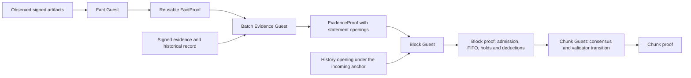

# Evidence proofs and mandatory sanctions

Objective offences are proven off chain and admitted on chain. The Fact Guest
compresses exact cryptographic verdicts, the batch Evidence Guest proves offences
against authenticated history, and the Block Guest admits each proven statement
and executes the mandatory sanction queue. Chunk proofs consume the block-proven
effects without verifying evidence again. This split keeps expensive signature
and receipt checks out of block execution, makes a proven offence reusable across
blocks and lets a statement about an arbitrarily old chunk cost the same as one
about the last chunk.

## Composition



The Fact Guest compresses exact cryptographic checks. The Evidence Guest
recursively verifies fact receipts and proves offences from historical
membership, signed-artifact bindings and explicit verdicts. The Block Guest
recursively verifies each EvidenceProof and authenticates its historical opening
against the block's incoming consensus anchor. The block state transition owns
replay protection, the bounded mandatory FIFO, withdrawal holds and deductions.
The Chunk Guest consumes the block-proven sanctions and binds only their anchor
and consensus effects ([chunk proofs](12-chunk-proofs.md)).

Every consensus BLS signature and VRF uses the `ConsensusDomain` derived from
the complete authenticated chain specification (`tag || chain_id LE8 ||
chain_spec_hash || payload`; [consensus](09-consensus.md)). Fact requests carry
these exact bytes, so a verdict or signed source from another specification
cannot establish a local offence even when both specifications share the
numeric chain ID and the validator keys. A signature on chunk `c` verifies under
the domain in force at `c`, so offences signed before a hard fork stay
punishable after it ([upgrades and forks](20-upgrades-and-forks.md)).

Evidence statements bind a historical record, never the current chain tip, so
one proof can be admitted in any block. History is a counted 64-level Merkle
tree of finalized chunk contexts ([recursive history](13-recursive-history.md));
its root comes from the previous finalized chunk, never from the current
chunk's future certificate. The verifier pins the Fact, Evidence and Block
program identities and the composed public statements bind them.

Missing signatures, malformed proofs, verifier panics and resource failures
never establish guilt. The protocol guarantees processing of admitted evidence
while the chain progresses. It does not claim discovery of hidden signatures or
inclusion of any particular off-chain report.

## Offences

`SanctionKind` selects the admission rules:

| Kind | Class | Penalty |
| --- | --- | --- |
| `Slash` | safety | the whole slashable balance; the identity is ejected and never seated again |
| `Inactivity` | liveness | governed `inactivity_leak_amount` (default 0: disabled) |
| `Abandonment` | liveness | governed `abandonment_penalty_amount` (default one token) |

Safety offences are the `SlashingEvidence` variants; liveness offences are the
other `EvidenceClaim` variants. Each offence has an evidence-independent
`offence_id = penalty_id(kind, validator, scope, round)` over the kind byte, the
offender's BLS key and withdrawal account, the scope (slot or chunk) and the
round. Reordering votes, changing a diagnostic field or citing a different
locking quorum therefore yields the same offence.

| Offence | Evidence | Penalty kind |
| --- | --- | --- |
| Double header | `DoubleProposal`: two headers signed for one slot | 0 |
| Prevote equivocation | `DoublePrevote`, or `ConflictingNilVote` in the prevote phase | 2 |
| Precommit equivocation | `DoublePrecommit`, or `ConflictingNilVote` in the precommit phase | 3 |
| Lock violation | `LockViolation` | 4 |
| Invalid proof acceptance | `InvalidProofSigning` | 5 |
| DA commitment fraud | `DaCommitmentFraud` | 6 |
| Inactivity | `EvidenceClaim::Inactivity` | 7 |
| Double round proposal | `DoubleBftProposal`: a round leader's two proposals for one round | 8 |
| Invalid execution claim | `InvalidExecutionClaim` | 9 |
| Abandonment | `EvidenceClaim::Abandonment` | 10 |

Every equivocation form in one vote phase shares that phase's kind, so one
offence is never deducted twice. A failed VRF claim is no offence: such a header
can never become canonical, and an honest producer signs one on a projection that
loses.

### Lock violations

Both BFT phases carry a mandatory `VoteAttestation` per signer
([BFT protocol](10-bft-protocol.md)). A prevote attestation signs the exact
optional unlock declaration; a precommit attestation also signs the count and
root of the ordered proof envelopes the signer accepted. `LockViolation` proves
an earlier signed precommit with its lock quorum followed by a conflicting vote
without a valid independent justification. For a later prevote the unlock
quorum must be from a round strictly between the lock round and the prevote's
round; a later precommit may use its own round's prevote quorum. This closes the
circular case in which illegal conflicting prevotes form the quorum later used
to excuse their precommits.

The verifier sees only the cited precommit and the later signed declaration, so
an honest signer declares its lock's quorum (or a newer one for the same target)
even when it prevotes its lock target again; the driver does so, and a bare
`None` against an earlier conflicting precommit is an offence. Certificate
validity authenticates the declarations and carried quorums; it does not show
that no hidden historical offence exists.

### Invalid proof acceptance

`InvalidProofSigning` binds the exact block proof envelope through a bounded
`ProofAcceptanceOpening` under the participant's signed acceptance commitment.
The opening names the envelope's canonical chunk position, the count and the
sibling shape. Full distinct manifests stay in signed vote and certificate
dictionaries, so observers can find receipt identities and build openings
without a root-only availability assumption. The Fact Guest runs its
deterministic exact-byte rejection verifier, the Evidence Guest authenticates
that verdict, and `facts_commitment` commits the original signed evidence.

A rejection is relative to the verifier that judges it, and the Fact Guest runs
the current specification's, which a hard fork may replace (a new SP1 version
rejects every older receipt). `InvalidProofSigning` is therefore admissible only
for a vote on a chunk at or after `ChainSpec::first_chunk`, natively, in the
Evidence Guest and in the node's detection. Every other safety offence keeps its
pre-fork reach.

### Invalid execution claims

`InvalidExecutionClaim` charges a header whose claimed results a valid receipt
of the same block contradicts ([proof market](08-proof-market.md)). The
receipt's public inputs must equal the header-derived ones, including the
header's `inputs_root`, except for the result fields, at least one of which
differs. The Evidence Guest verifies the receipt by SP1 recursion under the
source chunk's Block program: the batch carries the receipt's exact public
values (`AcceptedReceipt`), the host attaches the compressed receipt after the
fact receipts, and the envelope must name that statement's key and public inputs
it binds. The Fact Guest refuses to assert a receipt valid; its software
verifier only establishes rejection.

The Evidence Guest also authenticates the header signature, the parent link and
the bindings against the chunk's History record. Block 1 and the first block
after a hard fork have no parent header (a fork keeps its genesis fields, so both
stay accusable). A claim against either names no parent and the boundary supplies
the parent hash, height and pre-state root; a parent header is refused for such
a block, so no header can stand in for the boundary. The claim is admitted once
the source chunk has finalized. An executing node that imports a diverging
candidate proves the honest execution and reports it
([reporter nodes](18-reporter-nodes.md)).

### Inactivity

Inactivity means non-inclusion in the source chunk's consensus-selected
precommit quorum. It never claims that a validator did not vote, and certificate
non-inclusion alone proves nothing: any quorum subset of published precommits
forms a valid certificate. For that reason the deduction defaults to zero, and a
block admitting a liveness claim whose governed amount is zero is invalid.

The first block of the following chunk selects the compact quorum before
execution; its signed commitment and the following chunk's BFT value fix the
selection ([proof market](08-proof-market.md)). The runtime records the source
chunk's absence lists by address and by BLS identity. A producer acknowledges
positive precommits only for signers the carried certificate left out (the
certificate already counts the rest). Signatures from chunk `k` can be
acknowledged in `k+1` and `k+2`; an inactivity claim is admitted only from `k+3`
(`PARTICIPATION_CHALLENGE_CHUNKS = 2`), only against an identity and account on
the absence lists and only without a positive acknowledgement. Enabling the
deduction also requires `evidence_max_age_blocks >= 3 * chunk_size`. The lists
and acknowledgements stay for the eight-chunk liveness window.

The Evidence Guest checks the submitted quorum's signed payload, bitmap and
aggregate signature against the authenticated finalized source target and
membership, through Fact verdicts or its own checked path. The claim commits
that quorum. Automatic inactivity jobs take the selected quorum from the
canonical following chunk's first body and defer while that body is
unavailable, never substituting a locally stored certificate. Competing
first-block selections can affect unfinalized state only; the following chunk's
BFT agreement chooses one.

### Abandonment

Abandonment charges a proposer whose signed header the canonical chain replaced
after the exclusive proof window ([proof market](08-proof-market.md)). The claim
carries the signed header `H`, the canonical header `F` at the same height and
an opening of `F` in the source chunk's `block_hash_root`. The Evidence Guest
checks the opening at index `F.height - start_height` over the chunk's exact
leaf count, `H.parent_hash == F.parent_hash`, `H != F`,
`F.slot >= H.slot + proof_exclusive_slots` and the proposer's signature under
the domain at `H.height`. The offence id is `penalty_id(10, validator, H.slot,
0)`. A block replaced inside the window, or one built on a parent the chain
dropped, establishes nothing.

Nodes build claims once the chunk holding `H.height` finalizes, from the signed
headers their slashing monitor observed and from the stale-subtree root headers
in `AbandonedHeaders` (written when a candidate turns stale, so a restart loses
none, and pruned below the liveness window), while the chunk's canonical headers
are retained.

## Fact and Evidence Guests

Individual BFT votes never wait for a fact proof. The Fact Guest takes up to 64
requests (`MAX_FACTS`) and commits one verdict per request. A request binds the
exact key, message (with chain and domain), signature, or a complete signed
block-proof envelope with its accepted block program. Positive equations are
batched; each negative verdict is established individually. An explicit false
verdict establishes cryptographic rejection; missing facts and operational
failures never do. A block receipt is asserted only rejected here.

A batch EvidenceProof commits `EvidenceBatch { fact_guest_vk_digest, count,
root }`: a counted Merkle root over 1 to 16 unique offence statements
(`MAX_EVIDENCE_BATCH`) and the fact program identity. Its rules authenticate
historical membership, quorum, locks, signed proof acceptance, chain policy and
penalty IDs. Shared facts are verified once, including a certificate reused by
several inactivity claims. The Evidence Guest takes an `EvidenceWitness`: the
chain specification, one `HistoricalChunk` record, the `EvidenceClaim`, the
current Block program and the optional reporter account.

## Statements and attachments

```rust
pub struct EvidenceStatement {
    pub chain_id: u64,
    pub chain_spec_hash: Hash,
    pub block_guest_vk_digest: [u32; 8], // current admission program
    pub context: EvidenceContext,        // historical record, see below
    pub offender: Validator,             // identity, account, historical stake
    pub kind: SanctionKind,
    pub offence_id: Hash,
    pub facts_commitment: Hash,          // the exact signed evidence
    pub reporter: Option<[u8; 32]>,
}

pub struct EvidenceContext {
    pub chunk_id: u64,
    pub chunk_hash: Hash,
    pub end_height: u64,
    pub validators_root: Hash,
    pub seed: Hash,
    pub source_block_guest_vk_digest: [u32; 8],
    pub source_runtime_code_hash: Hash,
    pub start_boundary: Hash,
}
```

The context commits the chunk, membership, seed, the Block program and runtime
in force at the chunk's start boundary, and that boundary, independently of a
certificate's signer subset, so different valid certificates produce the same
history root. Old proof-rejection verdicts are judged under the historical
`source_block_guest_vk_digest`; the statement's own `block_guest_vk_digest`
names the current admission program. A valid old receipt is never reinterpreted
under a new key to manufacture an offence.

`EvidenceSubmission { statement, history }` is the transaction: it commits only
the statement and its `HistoryPath` opening. `Body.evidence_proofs` carries one
`EvidenceArtifact` per submission, in order, outside the transaction, vote and
DA commitments ([block format](05-block-format.md)). An artifact holds the
statement's `EvidenceMembership` (the batch and a counted opening), the Evidence
program identity, the statement and the compressed receipt (at most 2 MiB,
`MAX_EVIDENCE_PROOF_BYTES`). Missing, extra, reordered, malformed or mismatched
attachments are rejected at execution and admission. Choosing another valid
proof or batch for a statement leaves the transaction unchanged.

Statement identity is `statement_id`, a tagged BLAKE3 commitment of the Evidence
program, the Fact program and the canonical statement. It excludes the history
path, so refreshing a path never creates another offence receipt. The reporter
account is part of the statement: relaying a receipt or refreshing its path
cannot change the destination, and changing the destination cannot change the
offence ID.

Network relay uses `EvidenceReport { artifact, history }` on the
`evidence_proofs` topic. The reporter supplies the 64-level path, so receivers
verify the opening without looking up the old record or keeping the full tree.

## Verification in execution and proving

The ordinary-execution host verifies every evidence receipt before WASM
execution; no supplied boolean authorizes a state change. The proving host
decodes and verifies each attachment once, then passes the compressed proof and
its pinned verification key through SP1's separate proof stream. The Block Guest
checks policy, historical bindings, exact statement membership and batch public
values, invokes native SP1 recursive verification and only then runs the state
transition. No proof bytes enter the STF input, no compressed-proof verifier runs
in the Block Guest, and production recursion cannot disable deferred
verification.

SP1 execution records recursive claims without establishing that the proof
stream matches them; the compressed circuit binds the accumulated claim digest
to the verified subproofs, including each program and public-values digest. Only
real compressed composition establishes recursive acceptance, and SP1's
execution report does not count the recursive assertion syscall, so its counts
cannot stand in for it.

The host's exact-receipt verifier decodes bounded envelopes once and passes the
proof to the SDK's typed verifier; circuit, successful exit, program identity,
exact public values and trailing-byte rejection are mandatory. The block shell
keeps an immutable validated-input token and executes that same input without
repeating the historical binding checks.

## Admission and the mandatory FIFO

`SubmitEvidence` transactions form the prefix of a block's transactions.
`EvidenceSubmission::binds` requires the statement's chain ID, specification hash
and Block program to match the anchor, the path to open the context at its
chunk index under the anchor's history root and count, and the source chunk to
have ended before the block. A safety claim may cite any finalized chunk; a
liveness claim must cite one of the eight preceding finalized chunks (for
incoming chunk `n`, sources in `[n.saturating_sub(8), n)`) and lie within
`evidence_max_age_blocks` of the source chunk's last block.

The runtime then rejects a replay (a liveness offence ID already marked, or a
safety identity already tombstoned), a duplicate inside the block, an ineligible
inactivity claim, a disabled liveness kind and more than
`evidence_admissions_per_block` admissions. Admission fixes the identity, kind,
offence ID, amount, reporter and the then-current `reporter_reward_bps` in a
`PendingSanction`, so later governance never reprices an admitted obligation. A
safety amount is the whole slashable balance (`u128::MAX`, clamped at
execution).

Every block executes the FIFO prefix of up to `evidence_executions_per_block`
obligations before ordinary transactions, with reserved gas (5,000 per execution
and 10,000 per admission). Pending deductions hold all withdrawals from the
offender's runtime account until the queue has processed them. Duplicate
submissions cannot duplicate a penalty or stall the queue. A zero-balance
outcome is an explicit receipt status (`InsufficientBalance`) and does not erase
the consensus sanction. Admitted obligations never expire, and a full queue
drains within 64 advancing blocks at default throughput.

The deduction takes active stake and queued unbonding not yet withdrawn.
Collateral belongs to the runtime withdrawal account, so several BLS identities
using one account share its funds, and no deduction exceeds what the account
holds. For a safety offence with a reporter, the runtime credits
`floor(deducted * reporter_reward_bps / 10_000)` to the reporter and burns the
rest; liveness offences and zero deductions pay nothing. The reward rule and
settlement totals are runtime economics ([reporter nodes](18-reporter-nodes.md)).

A safety admission also returns the offender address's registration to the
offending key and drops every consensus candidate carrying that identity. The
identity-sanction transition, natively and in the Chunk Guest, ejects the
identity and every seat at the offender's address at the next boundary, whether
or not any runtime balance remains ([validator keys](19-validator-keys.md)).

## Parameters

| Parameter | Default | Rule |
| --- | --- | --- |
| `evidence_max_age_blocks` | 1,024 | governable; `0 < value < unbonding_delay_blocks`; liveness only |
| `evidence_max_pending` | 1,024 | governable; at most 4,096 |
| `evidence_admissions_per_block` | 16 | governable; nonzero, at most `evidence_max_pending` |
| `evidence_executions_per_block` | 16 | governable; nonzero, at most `evidence_max_pending` |
| `inactivity_leak_amount` | 0 | governable; nonzero requires `evidence_max_age_blocks >= 3 * chunk_size` |
| `abandonment_penalty_amount` | 10^18 wei | governable; zero disables the offence |
| `reporter_reward_bps` | 1,000 | governable; 0 to 10,000 |
| `unbonding_delay_blocks` | fourteen days of slots | chain spec; greater than `chunk_size` |
| liveness chunk window | 8 chunks | protocol constant `HISTORY_RETENTION_CHUNKS` |

The chain spec also requires `weak_subjectivity_period_secs <=
unbonding_delay_blocks * slot_duration_secs`. A policy is valid only if its
mandatory gas (executions, admissions, the participation-acknowledgement
reserve and proving settlement) fits the block gas limit. Governed values live
in `runtime:policy` and change after the delays in
[upgrades and forks](20-upgrades-and-forks.md). The STF asserts the anchor and
policy invariants on every block. `EvidenceAnchor` carries the genesis-fixed
unbonding delay, chunk size, block gas limit and proving-input bound beside the
program identities and history root.

## Replay protection

A liveness admission writes a per-offence marker, listed in the expiry bucket of
its admitting height and swept by the block one unbonding delay later. The
unbonding delay exceeds every governable liveness window, so a swept marker can
never bind again.

A safety admission writes a permanent tombstone keyed by the offender's BLS
public key. Consensus ejects a tombstoned identity at the next boundary and never
seats it again, so a second safety claim against that key, from any chunk and at
any time, is rejected. The number of tombstones is bounded by the identities
ever sanctioned. Safety evidence has no age window: the fixed-depth opening costs
the same at any age, and a continuously staked identity stays accountable for an
arbitrarily old offence whenever someone preserved its evidence. The unbonding
delay bounds only the withdrawal exposure after exit.

## Node evidence pool

Full and validator nodes keep no full History tree. A bounded frontier
authenticates appends, and cached paths cover retained records and recent
boundaries; older safety reports carry their own opening. An incoming report's
path may target the current finalized root or one of the eight preceding roots.
The receiver verifies the opening before the expensive receipt verification,
advances it over the bounded finalized append suffix with the frontier and each
appended context, and rechecks it before storing, so concurrent finalization
cannot install a path bound to an obsolete root. An older anchor is deferred for
the reporter to refresh.

The pool stores each report as `StoredEvidenceReport { report, history_root }`
in `EvidenceProofs`, keyed by statement ID; the 32-byte root is local
verification metadata. A report is active when its path targets the current
finalized root and dormant otherwise. Each finalized append atomically advances
cached and active paths; restart checks active paths against the finalized root
and dormant ones against their saved root. A newer path for a pooled statement
replaces the path and root and keeps the first verified proof attachment.
Archives keep the complete tree and can open any finalized index.

A snapshot jump can omit the append data needed to refresh an old leaf.
Installation removes receipts covered by the snapshot's finalized state and
refreshes reports whose contexts match supplied recent openings; the rest stay
dormant. A dormant report never enters block selection or blocks finalization,
and its holder must supply a fresh path before admission.

Block selection takes only active receipts proven under the Evidence, Fact and
Block programs of the next block. Pool rules:

- The pool holds at most 256 reports and 32 MiB, active and dormant together,
  including paths and saved roots. When full, a report with a current path
  displaces dormant liveness receipts first, then (for a safety report only)
  dormant safety receipts, then (for a safety report only) active liveness
  receipts, longest-dormant first in each class. Anyone can prove absence from
  some sub-quorum of a real certificate, so liveness receipts never keep a
  safety admission out.
- A liveness receipt the runtime will never admit (its challenge window is open
  and the certificate counted the validator or a positive signature was
  acknowledged) is refused.
- A safety identity is accountable once, and the node applies that before any
  expensive work. A distinct receipt or raw report against a key the head state
  has tombstoned, that finalized history has sanctioned, or that a ready pooled
  safety receipt under the current Evidence program covers is neither verified,
  stored nor proven. A network receipt in that position is deferred, since it is
  redundant rather than wrong. A dormant receipt, or one under a superseded
  program, shields nothing, and the exact pooled statement may still receive a
  newer path. The pool therefore holds at most one ready safety receipt per
  identity under the current program.
- Finalizing a safety admission records the identity in `FinalizedSlashes` beside
  the offence in `FinalizedOffences`; the next pruning pass releases every pooled
  receipt and raw report against that key.
- Liveness receipts leave when their window is behind finalized history under
  the finalized policy; safety receipts have no age floor.
- A receipt proven under programs that neither the first unfinalized chunk nor
  the head's next block uses leaves the pool, and its raw reports are proven
  again under the current programs.
- Only finalized facts release receipts. Receipts executed on an unfinalized
  branch stay available across reorgs, and an unreadable finalized policy prunes
  nothing.

Raw misconduct reports live in `SlashingPool`, keyed by the BLAKE3 hash of the
encoded `SlashingEvidence`, at most 1,024 entries (oldest out first) and four per
accused identity, so a detected offence survives a crash. Non-reporter nodes
gossip them on the `slashing_evidence` topic; reporter nodes keep them local
until a proof-bound report is ready.

## Fact cache and scheduling

Fact receipts are local acceleration artifacts and are never gossiped. A
bounded queue of eight jobs, each at most 2 MiB, feeds one blocking worker. The worker coalesces
up to eight further queued groups for the same fact program without a timer,
deduplicates facts and proves misses in groups of at most 64; a full queue skips
the optional precomputation, and evidence proving fills missing facts on demand.
Facts are proven under the fact program of the chunk being built.

The cache keeps at most 256 receipts and 32 MiB per fact program in
`facts-<circuit version>-<fact key>` under the node's cache directory, and keeps
two such directories. Fresh receipts are verified before insertion; persisted
receipts are size-bounded, decoded and verified again on restart, and corrupt or
misnamed files are deleted. Losing the cache only costs recomputation.

One evidence worker runs at a time, outside the engine lock. Startup, network
initialization, evidence arrival, finalization and production trigger it. A pass
takes up to eight raw reports, rotating through the raw pool so none starves,
then fills up to sixteen witnesses with inactivity and abandonment claims from
the eight-chunk window. Failed jobs keep
their inputs for retry. The block builder reserves mandatory execution gas and
bounds attachment plus ordinary transaction bytes.

## Verification

Native execution, execution-only Guest runs and mock recursion do not establish
real compressed composition, and mock SP1 receipts are never accepted by the
production evidence verifier. The `#[ignore]`d tests in
`crates/runtime-host/tests/evidence_pipeline.rs` establish it:

- `evidence_block_chunk_real_compressed_recursion` (CPU) proves the first chunk,
  then FactProof, batched EvidenceProof, a block that recursively verifies the
  statement and executes its deduction, and the successor chunk that verifies the
  first chunk's proof and applies the sanction. It starts from a trusted
  finalized history fixture.
- `evidence_block_chunk_cuda_compressed_recursion` runs the same composition on
  an NVIDIA GPU (`cuda` feature; `NEUTRIN0_CUDA_DEVICE` selects the device) and
  verifies each stage with the CPU verifier.
- `receipt_verdicts_real_compressed` takes one real Block receipt through both
  polarities: acceptance by Evidence recursion for `InvalidExecutionClaim`, and
  worst-case rejection in the Fact Guest for `InvalidProofSigning`
  (`NEUTRIN0_PROVING_BACKEND=cpu|cuda`).

The composition tests save each verified stage under
`target/proof-acceptance/evidence-pipeline` (`NEUTRIN0_EVIDENCE_GATE_DIR`
overrides it). A stage identity binds the circuit version, the stage ELF, the
exact inputs and the expected statement; a restart reuses a stage only after
verifying it against that statement, and corrupt stages fail the run. A result
for one ELF never carries over to a changed program.
